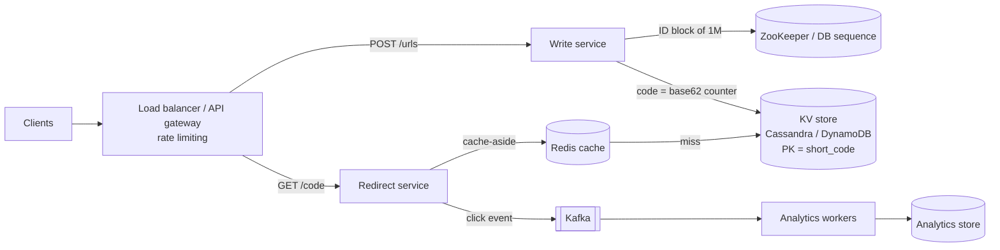

# Day 1 · URL shortener

**Phase:** Warm-up

**Number to memorize:**  62⁷ ≈ 3.5 trillion, so 7 base62 characters cover 100M URLs a day for ~95 years.

## Model solution

Source: [solution.mermaid](solution.mermaid)

**Decisions that matter most**

- **Primary key = `short_code`.** Dedup is optional, via a secondary index on a hash of the long URL.
- **Counter + base62 with ID blocks** handed to each write server from ZooKeeper or a DB sequence. No collisions, no single-counter bottleneck.
- **Split read and write paths.** Redirect service + Redis carries ~300K QPS at peak; the write service ~3K.
- **Analytics go async through Kafka**, so 302 redirects stay fast. Expiry uses a TTL or cleanup job.

## Points a strong answer also covers

**Requirements**
- Custom aliases (check-and-reserve), user-set expiry, analytics as a feature, abuse and per-user rate limits.
- Non-functional: redirect p99 < ~50 ms, ~99.99% availability, unguessable codes for private links.

**Estimations**
- Bandwidth: 100K reads/s × ~500 B ≈ 50 MB/s out; 1K writes/s × 500 B ≈ 0.5 MB/s in. Not a bottleneck, and say so.
- Servers: ~10K QPS per box → 300K peak needs ~30 redirect servers.
- Cache hit rate: 80/20 means the DB sees ~20K–60K QPS.

**API / data model**
- Status codes: 201, 301/302, 404, 410 Gone (expired), 409 Conflict (alias taken), 429.
- Bodies: `{long_url, custom_alias?, expires_at?}` → `{short_url, expires_at}`.
- Why a KV / wide-column store: no joins, key lookups only, horizontal scale, high availability.

**Deep dives**
- Sharding by `short_code` with consistent hashing (adding a node moves ~1/N keys).
- Hot keys: local in-process cache, replicate hot keys across shards, CDN/edge redirects.
- Failures: Redis down → DB needs headroom; ID service down → servers keep using their blocks; DB node down → RF=3.
- ID blocks lose unused IDs on crash (fine with headroom); sequential codes are guessable, so shuffle bits or salt.
- Dedup race: conditional write on the secondary index, or accept rare duplicates.
- Multi-region: local read replicas; writes need a global allocator or a region prefix in the ID.

**Wrap-up**
- Monitor redirect p99, cache hit rate, 404 rate, write errors, ID-space burn rate.
- Bottlenecks in order: cache hit rate, hot keys, the ID allocator.
- Trade-offs to revisit: 301 vs 302, whether dedup is worth an index, NoSQL vs SQL.
